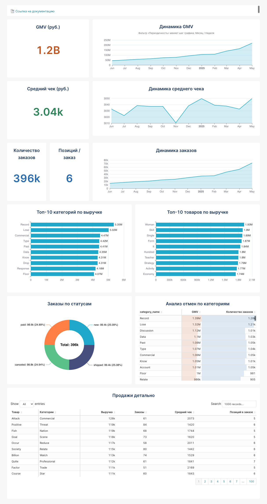
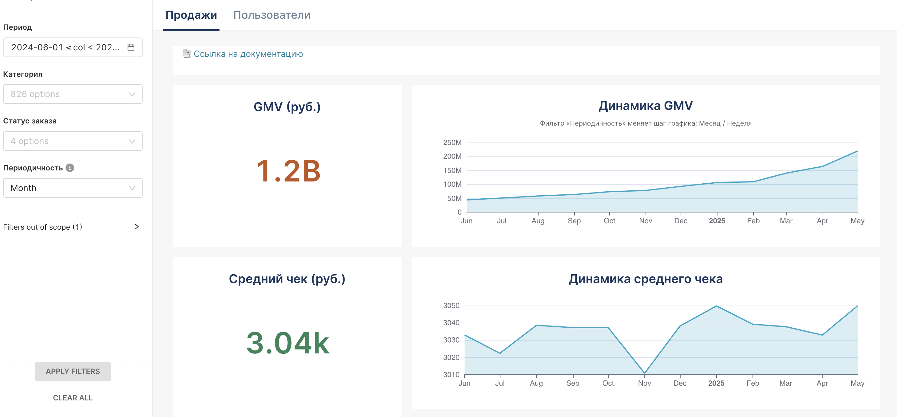
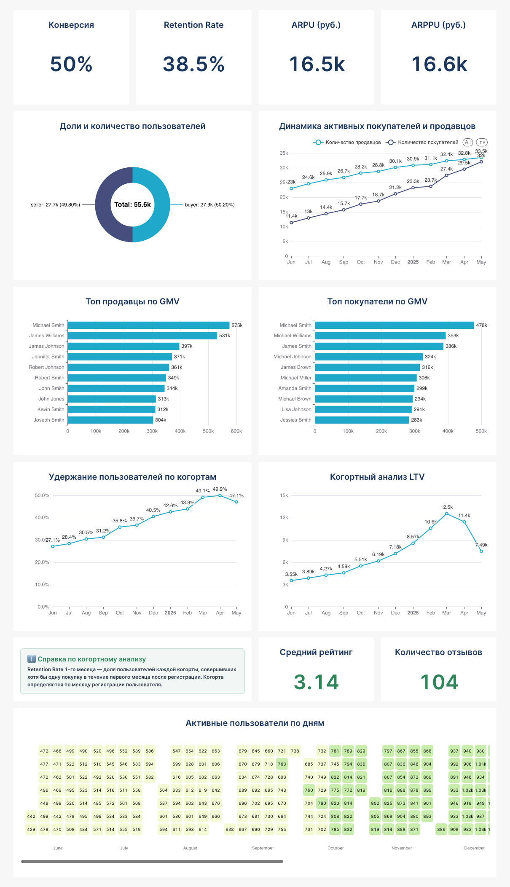

# Sales & User Analytics Dashboard

## Project Overview

An interactive BI dashboard designed to analyze sales performance and user behavior.

The project combines sales and customer analytics into two interconnected dashboard sections, helping track key business metrics, monitor trends, identify top-performing segments, and analyze user retention and lifetime value.

The dashboard provides a structured view of both business performance and customer behavior, supporting data-driven decision-making.

---

## Dashboard

### Sales Analytics

The Sales section provides an overview of key commercial metrics and sales performance over time.

Key metrics include:

- Gross Merchandise Value (GMV)
- Average Order Value
- Number of Orders
- Average Items per Order

The dashboard also includes:

- GMV trends over time
- Average order value dynamics
- Order volume dynamics
- Top categories by revenue
- Top products by revenue
- Order status distribution
- Cancellation analysis by category
- Detailed sales table

### Sales Dashboard



### Sales Dashboard Overview and Filters



---

## User Analytics

The User section focuses on customer and seller behavior, engagement, retention, and value.

Key metrics include:

- Conversion Rate
- Retention Rate
- ARPU
- ARPPU

The dashboard also provides insights into:

- Buyer and seller distribution
- Active buyers and sellers over time
- Top sellers by GMV
- Top buyers by GMV
- Cohort retention analysis
- Customer Lifetime Value (LTV)
- Average rating
- Number of reviews
- Daily active user patterns

### User Analytics Dashboard



---

## Key Business Questions

The dashboard helps answer questions such as:

- How is GMV changing over time?
- Which categories and products generate the highest revenue?
- How do order volume and average order value evolve?
- Which order statuses are most common?
- Which categories have the highest cancellation rates?
- Who are the top buyers and sellers by GMV?
- How are the numbers of active buyers and sellers changing?
- How well are users retained over time?
- How does customer lifetime value change across cohorts?

---

## Key Insights

*Period: June 2024 – May 2025. Educational dataset.*

### The marketplace is growing fast

- **GMV:** 1.2B RUB over the year. Monthly GMV grew **about 5×**, from ~45M to ~220M RUB.
- **Orders:** 396k in total. Monthly orders grew from ~15k to ~72k.
- **Average order value** stayed stable at ~3.0k RUB (3,010–3,050). Growth comes from **more orders, not bigger orders**.
- **Active buyers** almost tripled (11.4k → 32k), while active sellers grew more slowly (23k → 33.5k). Demand is catching up with supply.

### Retention is improving

- First-month retention rose from **27% (June 2024 cohort) to ~50% (March–April 2025 cohorts)**. Newer users come back more often.
- LTV grows for each newer cohort up to March 2025 (3.6k → 12.5k RUB). The drop for the latest cohorts is expected: they have had less time to make purchases, so they should not be compared with older cohorts yet.

### The main problem: cancellations

- **About 25% of all orders (98.8k) were cancelled.** This is the largest lost-revenue area on the dashboard.
- Cancellations are spread evenly across categories (~1M RUB GMV each in the top categories), so the cause is likely **process-wide** (payment, delivery, stock) rather than tied to specific products.

### Metric notes

The user base contains two roles: **buyers (50.2%)** and **sellers (49.8%)**. This explains two values that may look unusual at first:

- **Conversion = 50%.** It is calculated over all users, including sellers, who do not place orders. Almost every registered buyer made at least one order, so the figure effectively equals the share of buyers. For a marketplace it is more accurate to calculate conversion **among buyers only**, where it is close to 100%.
- **ARPU (16.5k) ≈ ARPPU (16.6k).** ARPU is calculated per buyer. Since almost all buyers are paying customers in this period, revenue per user and revenue per paying user are nearly the same. In a real business, the gap between them would show the share of non-paying users.

In a production dashboard I would show these metrics separately for buyers and sellers.

### Recommendations

1. Investigate the cancellation funnel: at which status orders are cancelled and why.
2. Keep tracking retention by cohort to confirm the growth is sustainable.
3. Encourage reviews: only 104 reviews for 396k orders is too few to judge product quality (average rating 3.14).

---

## Filters and Interactivity

The dashboard allows users to analyze data using interactive filters, including:

- Date period
- Category
- Order status
- Time granularity

The time granularity filter allows users to switch between different aggregation levels for trend analysis.

---

## SQL Queries

The analytical datasets used in Apache Superset were prepared using SQL queries.

The project includes two main queries:

- [**Orders Query**](sql/orders_query.sql) — combines orders, order items, products, categories, buyers, sellers, and reviews into an analytical dataset for sales analysis.
- [**Users Query**](sql/users_query.sql) — combines user information with order history to support customer behavior, activity, conversion, retention, and cohort analysis.

The queries use:

- Common Table Expressions (CTEs)
- `LEFT JOIN`
- Window functions
- `ROW_NUMBER()`
- `SUM() OVER`
- `AVG() OVER`

---

## Documentation

Detailed project documentation, including data preparation, metrics, dashboard logic, and analytical approach, is available here:

[**View Project Documentation**](https://docs.google.com/document/d/1kQzNIiv_Q7FOGYoxDBRMefCH3sK8BFvGjqr9KAd9ToY/edit?tab=t.0)

---

## Tools

- Apache Superset
- SQL

---

## Project Structure

```text
01_bi_sales_and_user_analytics/
│
├── images/
│   ├── sales_dashboard.jpg
│   ├── sales_dashboard_overview.png
│   └── user_analytics_dashboard.jpg
│
├── sql/
│   ├── orders_query.sql
│   └── users_query.sql
│
└── README.md
```
